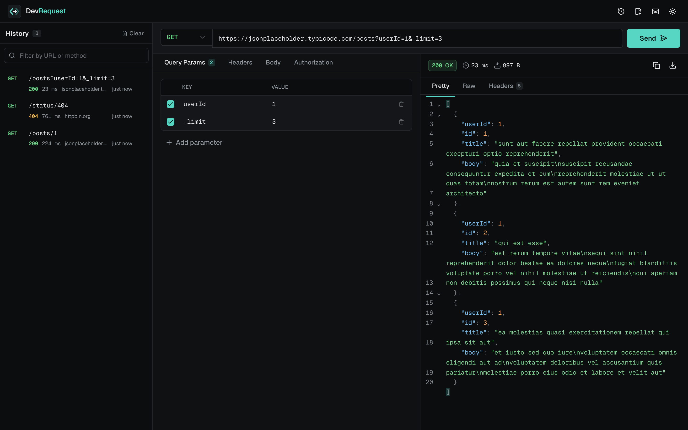
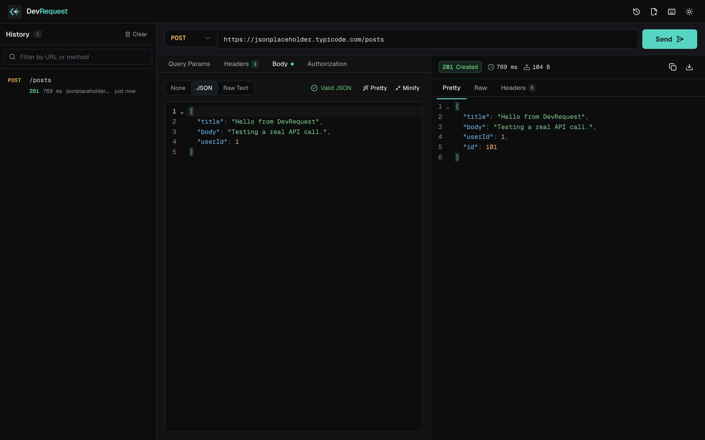
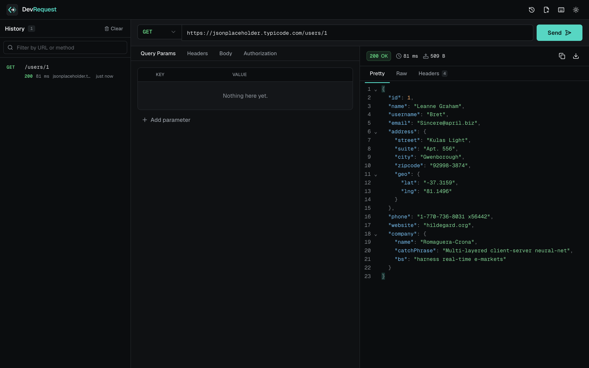
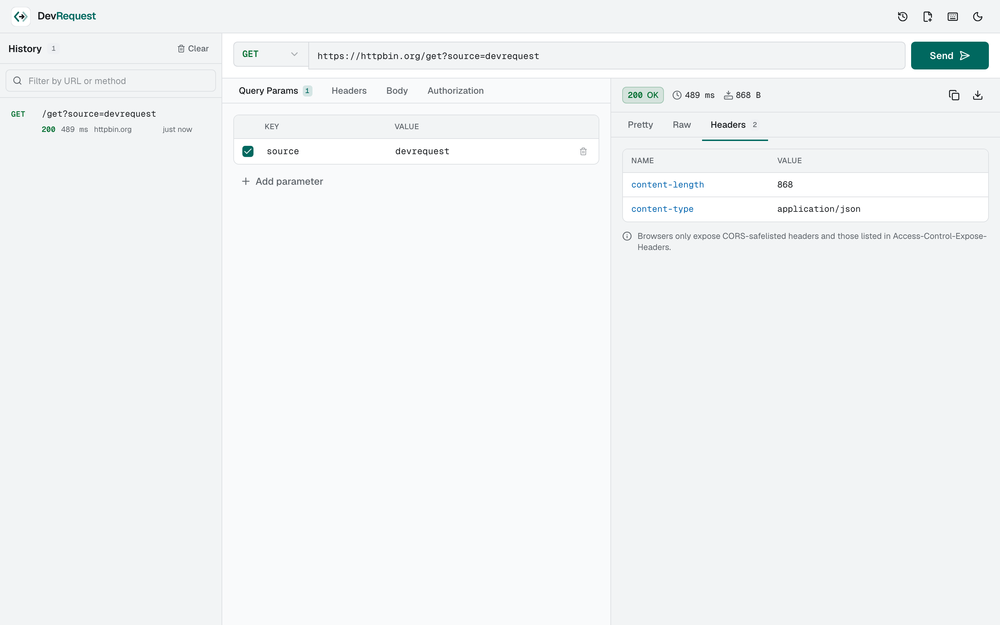
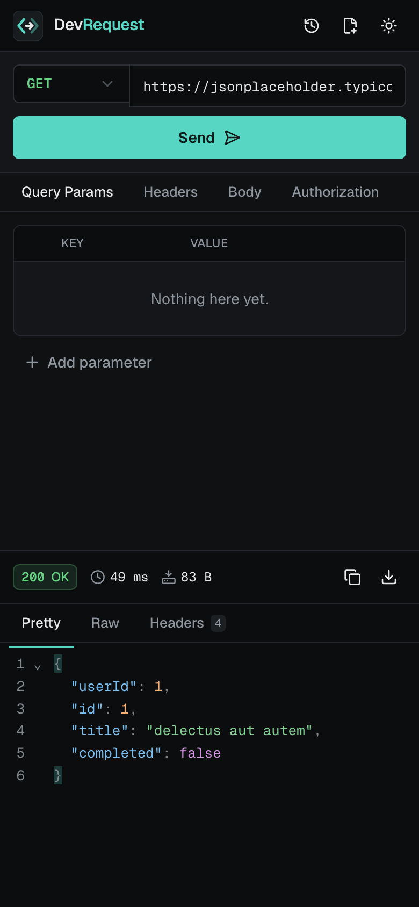

# DevRequest

Geliştiriciler için React ve TypeScript ile geliştirilmiş, gerçek HTTP istekleri gönderebilen modern ve hafif bir API test aracı.



## İçindekiler

- [Proje hakkında](#proje-hakkında)
- [Özellikler](#özellikler)
- [Teknoloji yığını](#teknoloji-yığını)
- [Ekran görüntüleri](#ekran-görüntüleri)
- [Kurulum](#kurulum)
- [Geliştirme komutları](#geliştirme-komutları)
- [Üretim derlemesi](#üretim-derlemesi)
- [Klasör yapısı](#klasör-yapısı)
- [Mimari kararlar](#mimari-kararlar)
- [HTTP isteklerinin çalışma mantığı](#http-isteklerinin-çalışma-mantığı)
- [Hata yönetimi](#hata-yönetimi)
- [Testleri çalıştırma](#testleri-çalıştırma)
- [CORS kısıtlamaları](#cors-kısıtlamaları)
- [Bilinen sınırlamalar](#bilinen-sınırlamalar)
- [Gelecekte geliştirilebilecek özellikler](#gelecekte-geliştirilebilecek-özellikler)

## Proje hakkında

DevRequest, Postman ve Insomnia gibi araçlardan ilham alan, tamamen tarayıcıda çalışan tek sayfalık bir HTTP istemcisidir. Kurulum, hesap veya sunucu gerektirmez; istekler doğrudan tarayıcının Fetch API'si ile hedef sunucuya gönderilir.

### Projenin amacı

- Bir API uç noktasını hızlıca denemek için hafif, hızlı açılan ve dikkat dağıtmayan bir araç sunmak.
- Tarayıcının gerçek davranışını (CORS, karışık içerik, zaman aşımı) gizlemeden, anlaşılır biçimde göstermek.
- Okunabilir, test edilmiş ve özellik bazlı bir React mimarisi örneği oluşturmak.

Uygulamada sahte yanıt, arka uç veya ücretli servis bulunmaz. Ekranda gördüğünüz her yanıt gerçek bir ağ isteğinin sonucudur.

## Özellikler

### İstek oluşturucu

- `GET`, `POST`, `PUT`, `PATCH` ve `DELETE` metotları
- URL doğrulama; şema yazılmazsa `https://` (yerel adreslerde `http://`) otomatik eklenir
- **Query Params:** ekleme, düzenleme, silme, aktif/pasif yapma ve URL ile **iki yönlü senkronizasyon**
- **Headers:** ekleme, düzenleme, silme, aktif/pasif yapma ve yaygın header adları için öneri listesi
- **Body:** None, JSON ve Raw Text modları
  - CodeMirror 6 tabanlı editör, JSON sözdizimi vurgulama, katlama ve parantez eşleştirme
  - Pretty Print ve Minify
  - Satır ve sütun bilgisiyle anlık JSON doğrulama; geçersiz JSON gönderilmez
- **Authorization:** No Auth, Bearer Token ve Basic Auth (UTF-8 uyumlu Base64)

### Yanıt görüntüleyici

- Renk kodlu HTTP durum kodu ve durum metni (`200 OK`, `404 Not Found` vb.)
- İstek süresi ve yanıt boyutu
- **Pretty**, **Raw** ve **Headers** görünümleri
- JSON sözdizimi vurgulama
- Yanıtı panoya kopyalama ve dosya olarak indirme
- Boş gövde (`204`) ve ikili içerik (görsel, PDF vb.) için özel durumlar
- Yönlendirilen isteklerde son URL bilgisi
- `400`, `401`, `404`, `500` gibi yanıtlar hata olarak değil, gerçek yanıt olarak gösterilir

### İstek geçmişi

- Gönderilen istekler `localStorage` içinde saklanır (en fazla 50 kayıt)
- Önceki bir isteği tek tıkla yeniden açma
- Tek kayıt silme, tüm geçmişi onay penceresiyle temizleme
- URL veya metoda göre filtreleme
- Birden fazla sekme açıkken geçmiş otomatik senkronize olur
- **Hassas bilgiler kaydedilmez:** Bearer token, Basic Auth bilgileri, `Authorization`, `Cookie`, `X-Api-Key` gibi header değerleri, `api_key`, `token` gibi query parametreleri ve URL içindeki `kullanıcı:parola@` bilgisi geçmişe yazılmadan önce temizlenir

### Kullanıcı deneyimi

- Varsayılan koyu tema, açık tema ve tercihin hatırlanması
- Klavye kısayolları ve kısayol yardım penceresi
- Toast bildirimleri, yükleme durumları ve geçen süre sayacı
- Anlamlı boş ve hata durumları
- Herkese açık API'lerle hazır örnek istekler
- Masaüstünde kenar çubuğu, mobilde açılır panel olarak çalışan geçmiş
- Klavye ile tam gezinme, görünür odak halkaları, ekran okuyucu etiketleri ve "içeriğe atla" bağlantısı
- `prefers-reduced-motion` desteği

### Klavye kısayolları

| Kısayol          | İşlem                    |
| ---------------- | ------------------------ |
| `Ctrl/⌘ + Enter` | İsteği gönder            |
| `Esc`            | Çalışan isteği iptal et  |
| `Alt/⌥ + L`      | URL alanına odaklan      |
| `Alt/⌥ + N`      | Yeni istek               |
| `Alt/⌥ + H`      | Geçmişi aç/kapat         |
| `Alt/⌥ + T`      | Temayı değiştir          |
| `?`              | Kısayol listesini göster |

## Teknoloji yığını

| Alan           | Teknoloji                                                    |
| -------------- | ------------------------------------------------------------ |
| Arayüz         | React 19, TypeScript 6                                       |
| Derleme        | Vite 8                                                       |
| Stil           | Tailwind CSS 4, shadcn/ui, Radix UI                          |
| İkonlar        | Lucide React                                                 |
| Kod editörü    | CodeMirror 6 (`@codemirror/view`, `@codemirror/lang-json`)   |
| Veri doğrulama | Zod 4 (`zod/mini`)                                           |
| Bildirimler    | Sonner                                                       |
| Yazı tipleri   | Geist ve Geist Mono (Fontsource ile yerel olarak paketlenir) |
| Test           | Vitest, React Testing Library, Playwright                    |
| Kod kalitesi   | ESLint (typescript-eslint strict), Prettier                  |

> TypeScript 7 yayınlanmış olsa da `typescript-eslint` henüz desteklemediği için proje, desteklenen en güncel sürüm olan TypeScript 6.0 ile yapılandırılmıştır.

## Ekran görüntüleri

Aşağıdaki görseller, uygulamanın üretim derlemesi üzerinde Playwright ile gerçek API'lere istek gönderilerek alınmıştır (`npm run screenshots`).

### Ana arayüz

Geçmiş, query parametreleri ve gerçek bir JSON yanıtı:


### İstek oluşturucu ve JSON gövdesi

JSON doğrulama, Pretty/Minify araçları ve `201 Created` yanıtı:



### Yanıt görüntüleyici

Sözdizimi vurgulamalı, katlanabilir JSON yanıtı:



### Açık tema ve yanıt header'ları



### Mobil görünüm



## Kurulum

Gereksinimler: **Node.js 20.19+** (önerilen 22 LTS) ve **npm**.

```bash
git clone https://github.com/zeynepbass/devrequest.git
cd devrequest
npm install
npm run dev
```

Uygulama varsayılan olarak `http://localhost:5173` adresinde açılır.

Uçtan uca testler ve ekran görüntüleri için Playwright tarayıcısını bir kez kurmanız gerekir:

```bash
npx playwright install chromium
```

## Geliştirme komutları

| Komut                  | Açıklama                                           |
| ---------------------- | -------------------------------------------------- |
| `npm run dev`          | Geliştirme sunucusunu başlatır                     |
| `npm run typecheck`    | TypeScript tip kontrolü yapar                      |
| `npm run lint`         | ESLint kontrolü yapar                              |
| `npm run format`       | Kodu Prettier ile biçimlendirir                    |
| `npm run format:check` | Biçimlendirme kontrolü yapar                       |
| `npm run test`         | Birim ve bileşen testlerini çalıştırır             |
| `npm run test:watch`   | Testleri izleme modunda çalıştırır                 |
| `npm run test:e2e`     | Playwright uçtan uca testlerini çalıştırır         |
| `npm run screenshots`  | README ekran görüntülerini yeniden üretir          |
| `npm run check`        | Tip kontrolü, lint ve testleri art arda çalıştırır |

## Üretim derlemesi

```bash
npm run build
npm run preview
```

`build` komutu önce TypeScript kontrolünü çalıştırır, ardından `dist/` klasörüne statik dosyaları üretir. Çıktı herhangi bir statik barındırma servisine (GitHub Pages, Netlify, Vercel vb.) doğrudan yüklenebilir; sunucu tarafı kod gerekmez.

Derleme, ilk yükleme boyutunu küçültmek için parçalara ayrılır:

- `react`, `ui` (Radix, Sonner, Lucide) ve uygulama kodu ilk açılışta yüklenir.
- CodeMirror (~315 KB) yalnızca bir editör ilk kez görüntülendiğinde `React.lazy` ile yüklenir.

## Klasör yapısı

```
src/
├── app/                       Uygulama kabuğu ve bileşim katmanı
│   ├── hooks/                 Çalışma alanına özel hook'lar (kısayollar, geçmiş paneli)
│   ├── providers/             Tema, tooltip ve bildirim sağlayıcıları
│   ├── App.tsx
│   └── workspace.tsx          Özellikleri bir araya getiren ana ekran
├── components/
│   ├── layout/                Header, kabuk, kenar çubuğu, kısayol penceresi
│   ├── shared/                Yeniden kullanılabilir bileşenler (kod editörü, key-value tablosu…)
│   └── ui/                    shadcn/ui temel bileşenleri
├── features/
│   ├── authorization/         Yetkilendirme paneli
│   ├── request-builder/       Metot, URL, sekmeler, body editörü, reducer
│   ├── request-history/       Geçmiş paneli, Zod şeması, saklama ve temizleme
│   └── response-viewer/       Durum, meta bilgiler, Pretty/Raw/Headers görünümleri
├── hooks/                     Genel hook'lar (istek yürütme, kısayol, pano, tema…)
├── lib/                       Platform, HTTP durumları, depolama yardımcıları
├── services/
│   └── http/                  İstek oluşturma, yetkilendirme, Fetch istemcisi, yanıt çözümleme
├── styles/                    Tasarım token'ları ve global stiller
├── test/                      Test kurulumu ve yardımcı fabrikalar
├── types/                     Paylaşılan tipler
└── utils/                     Saf yardımcı fonksiyonlar (URL, JSON, biçimlendirme…)
e2e/                           Playwright testleri ve ekran görüntüsü senaryoları
docs/screenshots/              README görselleri
```

## Mimari kararlar

- **Özellik bazlı yapı.** Her özellik kendi bileşenlerini, hook'larını ve modelini içerir. Özellikler birbirini doğrudan çağırmaz; `app/workspace.tsx` bunları bir araya getirir.
- **İş mantığı ile arayüz ayrımı.** HTTP katmanı (`services/http`) React'ten bağımsızdır ve saf fonksiyonlardan oluşur. Böylece tarayıcı olmadan test edilebilir.
- **Merkezi istek yönetimi.** Tüm istekler `useRequestExecution` hook'u üzerinden geçer. İptal, zaman aşımı, tekrar gönderim engeli ve durum geçişleri tek yerde yönetilir.
- **Reducer ile istek taslağı.** İstek durumu `useReducer` ile tutulur. URL ile parametre tablosu arasındaki iki yönlü senkronizasyon reducer içinde, saf ve test edilebilir biçimde yapılır.
- **Ayrık birleşim tipleri.** Yanıt durumu (`idle | loading | success | error`), yetkilendirme ve hata türleri TypeScript ayrık birleşimleriyle modellenmiştir; geçersiz durumlar tip düzeyinde engellenir. Projede `any` kullanılmaz.
- **Güvenilmeyen veriye karşı doğrulama.** `localStorage`'dan okunan geçmiş Zod şemasıyla doğrulanır; bozuk veya eski formattaki kayıtlar uygulamayı çökertmez.
- **Gereksiz soyutlamadan kaçınma.** Global durum kütüphanesi kullanılmadı; uygulamanın ihtiyacı React'in kendi araçlarıyla karşılanıyor.
- **Performans.** CodeMirror tembel yükleniyor, vendor kodu önbelleğe uygun parçalara ayrılıyor, tablo satırları ve geçmiş öğeleri `memo` ile gereksiz render'dan korunuyor, geçmiş filtresi `useDeferredValue` ile akıcı tutuluyor.

## HTTP isteklerinin çalışma mantığı

```
Taslak (RequestDraft)
   │  buildRequest()      URL doğrulama, header doğrulama, yetkilendirme, gövde ve JSON kontrolü
   ▼
Hazır istek (PreparedRequest)
   │  executeRequest()    fetch + AbortController + zaman aşımı + süre ölçümü
   ▼
Sonuç (ExecutionOutcome)  { ok: true, response } | { ok: false, error }
```

1. **Oluşturma:** `buildRequest` URL'yi normalleştirir ve doğrular, yalnızca aktif header'ları ekler, yetkilendirme header'ını üretir ve gövdeyi hazırlar. `GET` isteklerine tarayıcı kısıtı nedeniyle gövde eklenmez. JSON modunda `Content-Type` belirtilmemişse `application/json` eklenir.
2. **Gönderme:** `executeRequest`, isteği `fetch` ile gönderir. `credentials: 'omit'` ile tarayıcı çerezleri sızdırılmaz, `cache: 'no-store'` ile her istek gerçekten ağa gider.
3. **Ölçüm:** Süre, `performance.now()` ile isteğin başlangıcından gövdenin tamamen okunmasına kadar ölçülür. Boyut, çözülmüş yanıt gövdesinin bayt sayısıdır.
4. **Çözümleme:** Gövde `ArrayBuffer` olarak okunur, `Content-Type` içindeki karakter kümesine göre metne çevrilir ve türü (JSON, HTML, XML, metin, ikili, boş) belirlenir. Orijinal baytlar indirme için `Blob` olarak saklanır.
5. **İptal ve zaman aşımı:** Her istek kendi `AbortController`'ına sahiptir. Kullanıcı iptali ve 30 saniyelik zaman aşımı ayrı ayrı ayırt edilir.
6. **Tekrar gönderim engeli:** Bir istek sürerken yeni gönderimler yok sayılır ve kullanıcı bilgilendirilir.

## Hata yönetimi

Hatalar türlerine göre sınıflandırılır ve her biri için açıklama ile çözüm önerisi gösterilir:

| Tür              | Ne zaman oluşur                                                   |
| ---------------- | ----------------------------------------------------------------- |
| `invalid-url`    | URL boş, hatalı veya `http/https` dışında bir protokol kullanıyor |
| `invalid-header` | Header adı veya değeri geçersiz karakter içeriyor                 |
| `invalid-auth`   | Bearer token boş ya da Basic Auth kullanıcı adı eksik/geçersiz    |
| `invalid-body`   | JSON gövdesi geçersiz (satır ve sütun bilgisiyle)                 |
| `mixed-content`  | HTTPS sayfasından düz HTTP adresine istek atılmaya çalışılıyor    |
| `network`        | Bağlantı kurulamadı, alan adı yok, TLS hatası veya CORS engeli    |
| `offline`        | Tarayıcı çevrimdışı                                               |
| `timeout`        | Sunucu 30 saniye içinde yanıt vermedi                             |
| `aborted`        | İstek kullanıcı tarafından iptal edildi                           |

`4xx` ve `5xx` durum kodları bir **hata değil, geçerli bir HTTP yanıtıdır**; bu nedenle yanıt görüntüleyicide gövde ve header'larıyla birlikte, uygun renk koduyla gösterilir.

## Testleri çalıştırma

```bash
npm run test       # Vitest + React Testing Library
npm run test:e2e   # Playwright, üretim derlemesi üzerinde
```

Birim ve bileşen testleri şu alanları kapsar:

- HTTP metotları, URL oluşturma ve normalleştirme
- Query parametrelerinin URL ile senkronizasyonu
- Header yönetimi ve doğrulaması
- JSON doğrulama, hata konumu, Pretty Print ve Minify
- Yetkilendirme header'larının üretimi
- İstek yürütme, yanıt çözümleme, karakter kümesi ve içerik türü tespiti
- Ağ hatası, çevrimdışı durum, zaman aşımı ve iptal
- Tekrar gönderim engeli
- Geçmişin kalıcılığı, sınırı, bozuk veriye dayanıklılığı ve hassas bilgilerin temizlenmesi
- Klavye kısayolu eşleştirme
- Kullanıcı etkileşimleri: istek gönderme, parametre/header düzenleme, örnek istek, hata durumları, geçmişten yeniden açma ve tema değiştirme

Birim testlerinde ağ çağrıları test içinde taklit edilir; uygulama kodunda sahte yanıt bulunmaz. Playwright testleri ise gerçek herkese açık API'lere istek gönderir ve internet bağlantısı gerektirir.

## CORS kısıtlamaları

DevRequest tarayıcıda çalıştığı için tarayıcının güvenlik kurallarına tabidir:

- Hedef sunucu `Access-Control-Allow-Origin` header'ı döndürmüyorsa tarayıcı yanıtı JavaScript'e vermez. Bu durumda DevRequest isteği **başarılı gibi göstermez**; "Request failed" hatası ve olası nedenleri gösterilir.
- Tarayıcı, CORS hatasını DNS veya bağlantı hatalarından ayırt edilebilecek şekilde bildirmez; bu yüzden hata ekranı olası nedenleri birlikte listeler.
- Sunucu `Access-Control-Expose-Headers` ile izin vermedikçe yalnızca CORS-safelisted yanıt header'ları okunabilir. Headers görünümü bu sınırlamayı belirtir.
- `Cookie`, `Host`, `Origin` gibi bazı header'lar tarayıcı tarafından yasaklanmıştır ve gönderilemez.
- HTTPS üzerinden açılan bir sayfadan düz HTTP adreslerine istek atılamaz (yerel adresler hariç).

CORS'a izin veren API'leri test etmek için örnek olarak [JSONPlaceholder](https://jsonplaceholder.typicode.com) ve [httpbin](https://httpbin.org) kullanılabilir. Kendi API'nizi test ederken geliştirme ortamında CORS'u etkinleştirmeniz gerekir.

## Bilinen sınırlamalar

- Yukarıda anlatılan CORS ve yasaklı header kısıtlamaları tarayıcıdan kaynaklanır ve bir proxy olmadan aşılamaz.
- `GET` isteklerinde gövde gönderilemez.
- Yanıt boyutu, sıkıştırılmış aktarım boyutu değil çözülmüş gövde boyutudur.
- Zaman aşımı süresi 30 saniye olarak sabittir.
- Yanıtlar geçmişe kaydedilmez; yalnızca istek ve sonuç özeti (durum kodu, süre) saklanır.
- Geçmiş tarayıcıya özeldir ve cihazlar arasında senkronize edilmez.
- Kimlik bilgileri geçmişe yazılmadığından, geçmişten açılan isteklerde yeniden girilmeleri gerekir.
- `form-data`, `x-www-form-urlencoded` ve dosya yükleme gövdeleri henüz desteklenmez.
- Arayüz dili İngilizcedir.

## Gelecekte geliştirilebilecek özellikler

- Ortam değişkenleri (`{{baseUrl}}` gibi)
- Koleksiyonlar ve istekleri gruplama
- `form-data` ve `x-www-form-urlencoded` gövde türleri, dosya yükleme
- cURL içe ve dışa aktarma, kod parçacığı üretimi (fetch, axios, cURL)
- Ayarlanabilir zaman aşımı
- OAuth 2.0 ve API Key yetkilendirme türleri
- Geçmişi JSON olarak içe/dışa aktarma
- Yanıt üzerinde arama ve JSONPath filtreleme
- Çoklu sekme ile aynı anda birden fazla istek üzerinde çalışma
- Türkçe arayüz desteği (i18n)

## Lisans

[MIT](LICENSE)
